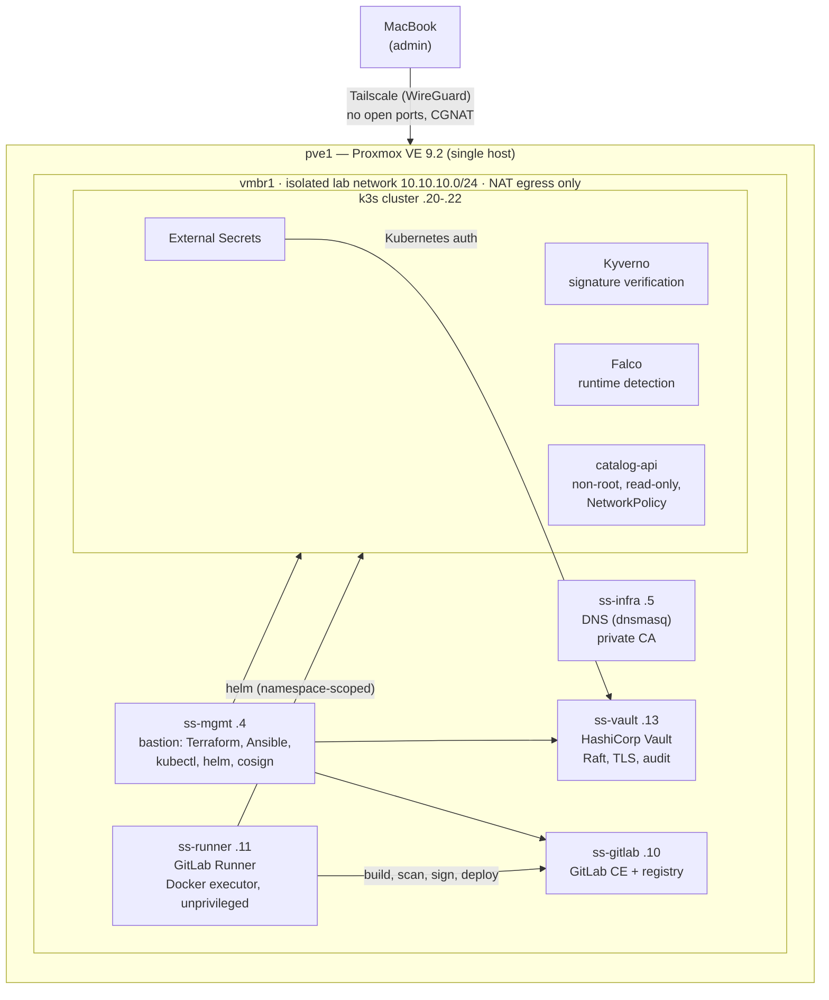

# SecureStream — an end-to-end DevSecOps lab

[](LICENSE)


SecureStream is a self-hosted platform for a fictional OTT (streaming) company, built on **one
physical Proxmox server** to practise DevSecOps the way it is done in production: infrastructure as
code, a private CA, a hardened CI/CD chain, secrets in Vault, and a Kubernetes cluster that only runs
images the pipeline has signed.

The workload lives in **[catalog-api](https://github.com/onurcarkcioglu/catalog-api)**; this repository
is the platform underneath it.

> **Public mirror.** The source of truth is a self-hosted GitLab. This GitHub copy is published by a
> pipeline job that removes encrypted secret files from the *entire* history before pushing
> (see [ADR-0008](docs/adr/0008-sanitized-public-mirror.md)). Code is public; secrets are not — not even encrypted.

---

## Architecture



| Host | IP | Role |
|---|---|---|
| pve1 | 192.168.0.127 / 10.10.10.1 | Hypervisor, NAT gateway, Tailscale subnet router |
| ss-mgmt | 10.10.10.4 | Bastion — the only place automation runs from |
| ss-infra | 10.10.10.5 | `securestream.lab` DNS (dnsmasq), CA signing host |
| ss-gitlab | 10.10.10.10 | GitLab CE 19.5.1 + container registry |
| ss-runner | 10.10.10.11 | GitLab Runner 19.5.0, Docker executor (`privileged = false`) |
| ss-sec | 10.10.10.12 | Reserved for SonarQube / DefectDojo (roadmap) |
| ss-vault | 10.10.10.13 | HashiCorp Vault 2.1.2 (Raft, TLS, file audit) |
| ss-k3s-cp / w1 / w2 | 10.10.10.20–22 | k3s v1.36.5: secrets encryption, API audit log, Traefik via MetalLB |

## What makes it a *security* project

| Area | Control | Evidence |
|---|---|---|
| Access | No port forwarding; Tailscale + bastion; key-only SSH with `AllowUsers` | CGNAT made port forwarding impossible — turned into a design choice ([ADR-0001](docs/adr/0001-tailscale-instead-of-port-forwarding.md)) |
| PKI | Two-tier private CA; root restricted by **name constraints** to `securestream.lab` and 10.10.10.0/24 | A leaked intermediate cannot sign `google.com` |
| IaC | Terraform (least-privilege Proxmox API token), Ansible roles, `--check --diff` before apply, second run `changed=0` | Idempotency checked for every role |
| Supply chain | CI tools pinned **by digest**, ~2-week cool-down, cosign signatures, signed CycloneDX SBOM | Motivated by the March 2026 Trivy compromise (CVE-2026-33634) |
| Admission | Kyverno `ImageValidatingPolicy`: images from our registry must carry our signature | An unsigned image in our own registry is rejected |
| Workload | Pod Security `restricted`, non-root, read-only rootfs, no capabilities, NetworkPolicy with **no egress** | `kubectl auth can-i` and network tests in the docs |
| Secrets | Vault (Shamir 5/3), External Secrets with Kubernetes auth (no static token), Ansible Vault, protected+masked+hidden CI variables | Root token revoked after setup; values never printed |
| Runtime | Falco (modern eBPF) | Shell in a container → alert with pod and namespace |
| Testing the controls | Every gate was broken on purpose and verified to fail **for the right reason** | [lessons-learned](docs/lessons-learned.md) |

Full mapping to **OWASP Top 10 CI/CD Security Risks, NIST SSDF (SP 800-218), SLSA and CIS Kubernetes**:
[docs/security-controls.md](docs/security-controls.md). Threat model: [docs/threat-model.md](docs/threat-model.md).

## Repository layout

```
infra/terraform/proxmox   VM definitions (bpg/proxmox provider), generated Ansible inventory
infra/ansible             roles: baseline, dns_server, dns_client, lab_ca, ca_trust, lab_cert,
                          k3s, gitlab, gitlab_runner, vault  ·  playbooks/  ·  inventory/
platform/                 Helm values, Kubernetes manifests, Vault policies, pinned versions
scripts/                  operational scripts (e.g. vault-unseal.sh)
docs/                     security controls, threat model, ADRs, runbooks, lessons learned, build log
```

## Reproducing it

The VMs add up to ~96 GB RAM and ~600 GB disk (vCPUs are overcommitted); this lab runs on a dual-Xeon ASUS Z10PE-D16 workstation board. The order is:

1. Proxmox network (`vmbr1` + NAT), Tailscale subnet router, cloud-init golden image.
2. `scripts/tf.sh apply` (Terraform in `infra/terraform/proxmox`; token in environment variables, never in files; the
   Proxmox API is verified against pve1's own CA, only for this process). State is kept in
   GitLab-managed Terraform state (`backend.tf`). On a rebuild from zero GitLab does not exist yet: run the first apply
   with `backend.tf` moved aside, then move it back and run `scripts/tfstate-token.sh` and `scripts/tfstate-migrate.sh`.
3. Ansible: `baseline` → `infra` (DNS + CA) → `k3s` → `gitlab` → `runner` → `vault`.
4. `platform/`: MetalLB, Traefik, cert-manager, Kyverno, Falco, External Secrets.
5. Push `catalog-api`; the pipeline does the rest.

Secrets are created on the bastion and moved only through pipes (`read -rs`, `ssh … | ansible-vault encrypt`),
never typed into files or chat. See [runbooks](docs/runbooks/).

## Documentation

- [Security controls and framework mapping](docs/security-controls.md)
- [Threat model (STRIDE)](docs/threat-model.md)
- [Architecture decision records](docs/adr/)
- [Runbooks](docs/runbooks/) — Vault unseal, secret leak response, rejected image, credential rotation
- [Lessons learned](docs/lessons-learned.md) — real incidents from building this
- [Build log (Turkish)](docs/engineering-log.md)

## License

[MIT](LICENSE)
