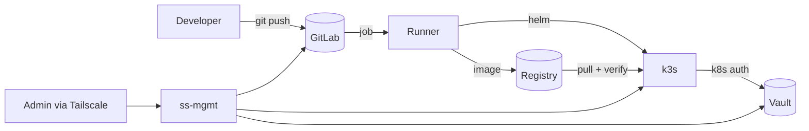

# Threat model (STRIDE)

**Scope:** the path from a developer commit to a running pod, plus the platform that supports it.
**Assets:** source code, CI credentials (signing key, deploy kubeconfig, registry tokens), container images,
Vault secrets, the Kubernetes cluster.
**Trust boundaries:** internet ↔ Tailscale; admin laptop ↔ bastion; GitLab ↔ runner; runner ↔ cluster;
cluster ↔ Vault; registry ↔ cluster.

| # | Threat (STRIDE) | Example attack | Controls in place | Residual risk |
|---|---|---|---|---|
| T1 | **Spoofing** — fake image | Attacker pushes a malicious image under a legitimate tag | cosign signature verified by Kyverno; deploy by digest | Signing key theft → see T6 |
| T2 | **Spoofing** — fake CI identity | Stolen runner token registers a rogue runner | Token in Ansible Vault, `no_log`, group-scoped runner, tagged jobs | Runner token has no expiry; rotation is manual |
| T3 | **Tampering** — poisoned dependency | Malicious or vulnerable package version | Pinned requirements, Trivy SCA, cool-down for tools | Zero-day in a pinned package until a CVE exists |
| T4 | **Tampering** — compromised CI tool | A scanner image itself is backdoored (Trivy, March 2026) | All tool images pinned by digest; versions changed deliberately | Digest pinned to an already-compromised release |
| T5 | **Tampering** — pipeline definition | Branch edits `.gitlab-ci.yml` to exfiltrate secrets | Secrets are *protected* variables → unavailable on unprotected branches | Maintainer-level account compromise |
| T6 | **Information disclosure** — secret in Git | Token committed or pasted | gitleaks on every commit (full history), ruff `S105`, public mirror strips secret files from history | Secrets shared outside Git (chat, screenshots) — handled by the leak runbook |
| T7 | **Information disclosure** — secret in logs | Token printed by a job or by Ansible | Masked/hidden variables, `--redact`, `no_log`, `read -rs` for humans | Debug logging added by mistake |
| T8 | **Repudiation** | "Who changed that secret / deployed that image?" | Vault audit log, k3s API audit log, GitLab audit events, signed commits roadmap | No central log store yet (Loki planned) |
| T9 | **Denial of service** | Vault sealed after a reboot → apps lose secrets | Unseal runbook + script; ESO keeps the last synced Kubernetes Secret | Manual unseal (no auto-unseal/KMS in the lab) |
| T10 | **Elevation of privilege** — container escape | Compromised app tries to reach the node | Non-root, read-only rootfs, no capabilities, seccomp, PSA `restricted`, Falco | Kernel zero-day |
| T11 | **Elevation of privilege** — CI → cluster admin | Deploy credential abused | Namespace-scoped Role; cannot read other namespaces' secrets or list nodes | Full control of the `catalog` namespace |
| T12 | **Lateral movement** from the app | Compromised pod scans the network or exfiltrates data | NetworkPolicy: ingress only from Traefik, **zero egress** | — |
| T13 | **Exposure** of management plane | Internet scanning of SSH / GitLab / Proxmox | No inbound ports at all (CGNAT + Tailscale); key-only SSH | Tailscale account compromise → protect with MFA |
